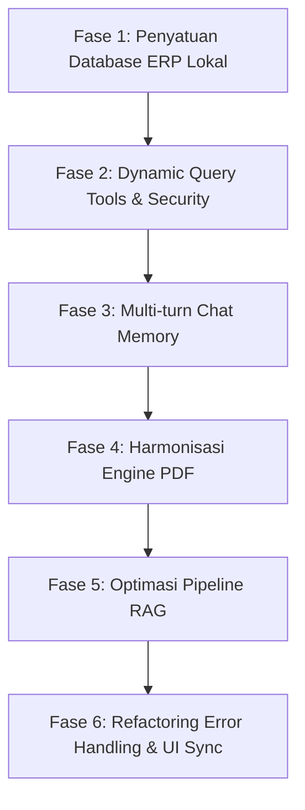

# 🚀 Master Implementation Plan: SmartSchool AI Assistant (ERP Add-on)

Dokumen ini memuat peta jalan pengembangan (*roadmap*) dan rencana eksekusi terstruktur untuk mengintegrasikan asisten AI SmartSchool secara optimal dengan database operasional ERP sekolah.

---

## 🎯 Sasaran Utama Arsitektur
1. **Single Source of Truth:** AI membaca langsung database operasional ERP sekolah secara *real-time* tanpa duplikasi atau ketergantungan data tiruan.
2. **Context-Aware & Multi-Turn Memory:** AI mengingat riwayat percakapan aktif pengguna sehingga komunikasi berlangsung alami dan kontekstual.
3. **Structured & Dynamic Tools:** AI mampu melakukan query data dinamis berdasarkan kelas, nama siswa, atau status tunggakan.
4. **Harmonisasi PDF Generator:** Menyatukan generator laporan resmi menjadi satu engine terpadu (ReportLab) yang menghasilkan dokumen resmi ber-kop surat sekolah.
5. **Robust RAG Pipeline:** Pencarian pedoman akademik (PPDB, tata tertib) berbasis chunking semantik di Qdrant Vector Cloud.

---

## 🗺️ Roadmap & Fase Implementasi

---

### Fase 1: Penyatuan Database ERP Lokal (Single Source of Truth)
- **Tujuan:** Menghapus ketergantungan Supabase pada data SPP dan mengarahkan seluruh query chat ke database PostgreSQL lokal ERP (`smartschool_db`).
- **Langkah Kerja:**
  1. Buat connection pool terpusat di `backend/app/services/db_service.py` menggunakan `psycopg2` / SQLAlchemy.
  2. Buat konfigurasi kredensial read-only (misal user `spp_reader`) agar AI terisolasi dan tidak memiliki hak akses destruktif (`INSERT/UPDATE/DELETE/DROP`) ke ERP.
  3. Refactor fungsi `get_spp_arrears` di `chat_router.py` agar mengeksekusi query langsung ke database ERP lokal.

---

### Fase 2: Dynamic Query Tooling & Role-Based Access Control (RBAC)
- **Tujuan:** Memberdayakan LLM untuk mencari data secara spesifik, bukan sekadar menarik seluruh isi tabel.
- **Langkah Kerja:**
  1. Perbarui skema fungsi OpenAI Tools `get_spp_arrears` dengan parameter fleksibel:
     - `filter_kelas` (opsional, contoh: "X MIPA 1")
     - `nama_siswa` (opsional, pencarian nama dengan `ILIKE`)
     - `status_pembayaran` (default: "BELUM LUNAS")
     - `mode` ("summary" untuk total agregat angka, "detail" untuk daftar siswa)
  2. Implementasikan query parameterized untuk mencegah SQL Injection.
  3. Perkuat validasi RBAC pada level API: pastikan hanya role Admin Keuangan/TU yang dapat memicu eksekusi query data keuangan.

---

### Fase 3: Multi-Turn Conversation Memory (Riwayat Chat)
- **Tujuan:** Menghilangkan amnesia pada AI saat pengguna mengajukan pertanyaan lanjutan.
- **Langkah Kerja:**
  1. Perbarui skema request di `backend/app/routers/chat_router.py` untuk menerima array `history: List[ChatMessage]` (5-10 pesan terakhir).
  2. Perbarui `frontend/src/services/chatService.ts` dan hook `useChatSession.ts` agar menyertakan riwayat pesan dari sesi aktif saat memanggil `/api/v1/chat`.
  3. Susun urutan pesan pada prompt OpenAI: `System Prompt` $\rightarrow$ `Riwayat Obrolan Terdahulu` $\rightarrow$ `Pesan Terakhir User`.

---

### Fase 4: Harmonisasi Engine Generator PDF Laporan Resmi
- **Tujuan:** Menghilangkan duplikasi engine (FPDF vs ReportLab) dan menghasilkan PDF biner resmi secara konsisten.
- **Langkah Kerja:**
  1. Standarisasi engine ke **ReportLab** (`backend/app/routers/pdf_router.py`) yang sudah memiliki layout tabel resmi, kop surat, dan styling korporat sekolah.
  2. Hubungkan tool `generate_spp_pdf` di `chat_router.py` untuk memanggil fungsi generator ReportLab dengan data live dari PostgreSQL lokal.
  3. Kembalikan URL unduhan lokal (`http://localhost:8000/api/v1/download-pdf/{file_id}`) yang langsung dapat dipratinjau (*preview*) atau diunduh dari bubble chat frontend.

---

### Fase 5: Optimasi Pipeline RAG & Dokumen Pedoman (Knowledge Base)
- **Tujuan:** Meningkatkan akurasi pencarian informasi tata tertib dan alur PPDB.
- **Langkah Kerja:**
  1. Perbaiki fungsi pemecah teks (`split_text_into_chunks`) agar menggunakan pemisah semantik (berdasarkan paragraf ganda `\n\n` dan heading bab), bukan pemotongan kasar per 800 karakter.
  2. Simpan metadata yang kaya pada setiap vektor Qdrant: nomor halaman, judul bab, dan nama dokumen.
  3. Perbaiki penanganan file PDF yang diunggah pengguna: jika teks melebihi 10.000 karakter, jalankan proses similarity search lokal/RAG alih-alih pemotongan paksa `[:12000]`.

---

### Fase 6: Transparansi Error Handling & Sinkronisasi UI Frontend
- **Tujuan:** Memudahkan pemantauan sistem dan mencegah kebingungan pengguna akibat silent fallback.
- **Langkah Kerja:**
  1. Ubah `chatService.ts` di frontend: jika backend live aktif namun mengembalikan error 500/koneksi gagal, tampilkan pesan status diagnostik yang informatif ke pengguna alih-alih langsung menyamarkannya dengan data mock.
  2. Pertahankan fitur "Mock Mode" hanya sebagai mode demo manual yang diaktifkan secara sadar lewat toggle navigasi atas.
  3. Pastikan indikator status di navbar (`TopNavbar.tsx`) akurat mencerminkan konektivitas real-time backend FastAPI.

---

## ⏱️ Estimasi Waktu & Skala Prioritas

| Prioritas | Fase | Dampak | Kompleksitas |
|:---:|---|---|:---:|
| 🔴 **P0 (Kritis)** | **Fase 1:** Penyatuan Database ERP Lokal | Data asli langsung terbaca | Rendah - Menengah |
| 🔴 **P0 (Kritis)** | **Fase 6:** Transparansi Error & Matikan Silent Mock | Debugging jelas dan akurat | Rendah |
| 🟡 **P1 (Tinggi)** | **Fase 2:** Dynamic Query Tooling | AI cerdas merespons detail spesifik | Menengah |
| 🟡 **P1 (Tinggi)** | **Fase 3:** Multi-Turn Chat Memory | Percakapan mengalir alami | Menengah |
| 🟢 **P2 (Sedang)** | **Fase 4:** Harmonisasi Generator PDF | Dokumen resmi konsisten | Rendah |
| 🟢 **P2 (Sedang)** | **Fase 5:** Optimasi Pipeline RAG | Pencarian pedoman lebih presisi | Menengah |
